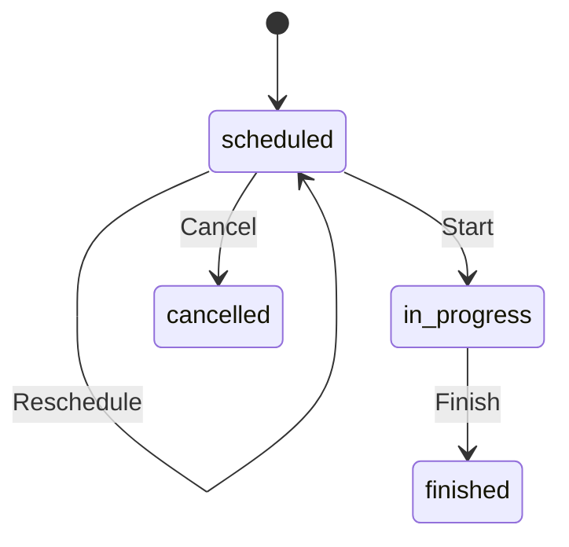

# Sports Event Platform

A TypeScript HTTP service for scheduling competitive matches, advancing their lifecycle, and retrieving events by ID, team, or sport. PostgreSQL stores the sport and team catalogs, scheduled start times, and current event state.

## Run locally

Use Node.js 26, Corepack, and Docker with Compose v2. Run the commands from the repository root.

```sh
npm install -g corepack
corepack enable
yarn install --immutable
yarn db:up
yarn migration:run
yarn db:seed
yarn dev
```

Compose starts PostgreSQL 18 on port 5432. On first initialization, the database image runs the SQL script that creates `sports_events` and `sports_events_test`. The development scripts load `.env.dev`. The seed command upserts five sports and twenty teams into the development database so the API examples can use known IDs.

The default HTTP port is 3000. `GET /health` checks database connectivity with `SELECT 1`. Interactive OpenAPI 3.1 documentation is available at [localhost:3000/documentation](http://localhost:3000/documentation).

```sh
yarn build
yarn start
```

The build emits JavaScript under `dist/`. The repository’s start script runs that output with Node and loads `.env.dev`. Runtime configuration includes `DATABASE_URL`, `NODE_ENV`, `HOST`, `PORT`, and `SHUTDOWN_TIMEOUT_MS`. Apply migrations separately before starting against a new database. Stop the local database with `yarn db:down`.

## Architecture and tooling

| Area | Responsibility and trade-off |
| --- | --- |
| HTTP | Fastify routes validate requests and serialize responses using Zod schemas that also feed OpenAPI. HTTP DTOs define the consumer contract. Explicit command routes give each transition its own payload and make the lifecycle visible in the API. |
| Application | Services translate commands and queries into repository calls. Event reads use a separate search interface for lists. The sport and team catalog services access TypeORM directly, which keeps the simple list paths short and couples those services to persistence. |
| Domain | The event aggregate and status value object own participant rules and lifecycle transitions. Domain classes are independent of HTTP and TypeORM schemas. |
| Persistence | PostgreSQL supplies relational constraints, row locks, and transactional writes. TypeORM EntitySchema mappings and migrations describe the stored model. Query builders make joins, locks, and version predicates explicit. Mappers translate between database rows and domain objects. |
| Runtime | Strict TypeScript, branded IDs, and discriminated state types catch invalid combinations at compile time. Zod validates inputs at runtime. TypeDI provides request-scoped dependency resolution while the application shares a single initialized TypeORM DataSource and connection pool per process. Fastify closes the DataSource when the app shuts down. |

Source entry points are `src/bootstrap.ts`, `src/http/`, `src/application/`, `src/domain/`, and `src/persistence/`.

## Domain model

| Type | Role and rules |
| --- | --- |
| `Sport` | Catalog record with a numeric ID and name. Events and teams refer to this ID. |
| `Team` | Entity with UUID identity, a sport ID, and a trimmed, nonempty name. |
| `SportsEvent` | Aggregate root with a UUID, a version, one sport, exactly one home team and one away team, a scheduled start, and lifecycle state. The teams must be distinct and belong to the event’s sport. Team records have their own persistence lifecycle. |
| `EventStatus` | Value object backed by a discriminated union. Each variant has its own allowed fields. Runtime schemas validate state when it is created or reconstructed. |



Starting records `startedAt`. Finishing retains `startedAt` and requires `finishedAt >= startedAt`. Cancelling requires a timestamp and a trimmed, nonempty reason. Finished and cancelled events are terminal. Branded IDs distinguish team and event UUIDs in TypeScript. Date values are copied to protect domain state from mutation through shared references.

Fixed home and away roles make participant validation and database constraints straightforward. The model assumes two teams per event. Additional sports can be added as catalog rows under the current rules. Sport-specific durations, participant formats, or metadata would require changes to the model and potentially the API and schema.

## Persistence and concurrency

The migration creates `sports`, `teams`, and `sports_events`. Composite foreign keys enforce that both teams belong to the event’s sport, and a check constraint keeps the teams distinct. Events store a PostgreSQL status enum and `timestamptz` timestamps. Mappers translate nullable lifecycle columns into domain-validated state variants.

| Index columns | Access pattern |
| --- | --- |
| `teams(sport_id)` | Sport-based team lookup and foreign-key checks. |
| `sports_events(home_team_id, status, scheduled_at)` and the matching away-team index | Event lookup by either team role. |
| `sports_events(sport_id, status, scheduled_at)` | Event lookup by sport. |

Public event searches are deliberately scoped to a team or sport to align with the leading index columns. The intervening `status` column can limit how well those indexes serve time ranges and sorting because the routes omit a status filter. Event details join both teams in one query. Lists return team IDs directly.

**Scheduling and rescheduling.** Multiple requests may compete to book the same team. Within a `READ COMMITTED` transaction, the repository locks both teams in ID order, checks for overlaps, and writes. The check covers both team roles, allows starts exactly 90 minutes apart, and excludes cancelled events and the event being moved. All scheduling writers must follow this locking protocol.

**Updating an event.** Version-based optimistic concurrency control protects lifecycle updates and reschedules to the same event, where concurrent edits are expected to be rare.

## HTTP API

The HTTP API uses resource-oriented reads and deliberately uses domain verbs for writes. Commands such as `schedule`, `reschedule`, and `cancel` appear in route paths. This departs from strict REST conventions and makes the intended lifecycle operation explicit in the client contract. Successful commands and reads return HTTP 200.

| Method and path | Input |
| --- | --- |
| `POST /events/schedule` | `sportId`, `homeTeamId`, `awayTeamId`, `scheduledAt` |
| `POST /events/:id/reschedule` | `scheduledAt` |
| `POST /events/:id/start`, `POST /events/:id/finish` | `at` |
| `POST /events/:id/cancel` | `reason`, `at` |
| `GET /events/:id` | Event UUID |
| `GET /teams/:teamId/events`, `GET /sports/:sportId/events` | Optional `after`, `before`, `limit`, `offset`, `sort` |
| `GET /teams`, `GET /sports` | Optional `limit`, `offset` |

Use ISO 8601 timestamps with a timezone. Search applies an exclusive `after` and an inclusive `before` to the scheduled start. The default page is 50 items at offset 0, with a maximum of 100 items per request. Event lists sort by scheduled time ascending by default and break ties by event ID ascending. To retrieve upcoming events, pass the current time as `after`. Collection responses are arrays. Event details and command responses embed teams and a nested status object. Event collections return team IDs, a status string, and nullable lifecycle fields.

After seeding the local database, schedule a match and copy its returned `id` for the detail request.

```sh
curl -sS http://localhost:3000/events/schedule \
  -H 'Content-Type: application/json' \
  -d '{"sportId":1,"homeTeamId":"550e8400-e29b-41d4-a716-446655440001","awayTeamId":"550e8400-e29b-41d4-a716-446655440002","scheduledAt":"2027-01-15T18:30:00Z"}'

curl -sS "http://localhost:3000/events/${EVENT_ID}"

curl -sS 'http://localhost:3000/sports/1/events?after=2027-01-01T00:00:00Z&before=2027-02-01T00:00:00Z&limit=20'
```

The central error handler returns a JSON object with `code` and `message`, with the missing event or team ID when available.

| HTTP | Codes |
| --- | --- |
| 422 | `VALIDATION_ERROR` |
| 404 | `NOT_FOUND` for missing event or team records in operations that require them |
| 409 | `DOMAIN_ERROR`, `TEAM_SCHEDULE_CONFLICT`, `CONCURRENT_MODIFICATION` |
| 503 | `REQUEST_TIMEOUT` |
| 500 | `INTERNAL_ERROR` for unexpected or response serialization failures |

## Testing

Start PostgreSQL as shown above. The integration suites expect the schema to exist in `sports_events_test`. Apply the migration to that database before the first run.

```sh
node --env-file=.env.test ./node_modules/typeorm/cli-ts-node-esm.js migration:run -d src/persistence/data-source.ts
yarn typecheck
yarn lint
yarn test
```

Jest runs compiled TypeScript. Unit tests exercise identities, aggregate versions, participant invariants, lifecycle transitions, and persistence mapping. PostgreSQL integration tests cover event writes, searches, stale updates, and competing schedules that share a team. HTTP tests use Fastify injection to exercise routes, validation, error responses, and OpenAPI. This structure keeps state-rule tests local and checks database-dependent guarantees against the real database.

## Assumptions and known limitations

- Every booking occupies 90 minutes from its scheduled start. Actual start and finish timestamps do not change the reservation. Finished events still count for overlap checks in their planned interval.
- The HTTP API has no authentication, authorization, idempotency keys, or client-supplied expected version. A timeout does not tell the caller whether a database write committed.
- The service stores current event state. Match results, statistics, lifecycle history, and external feed integration are outside the implemented scope.

## Behavior as load grows

HTTP instances can share PostgreSQL while preserving the team-locking protocol. Scheduling throughput for a popular team is bounded by serial access to its row locks. Requests for disjoint teams can proceed concurrently. Concurrent updates to the same event can produce version conflicts. As history grows, deep offsets can increase database work and page contents can shift when events are inserted or moved.
